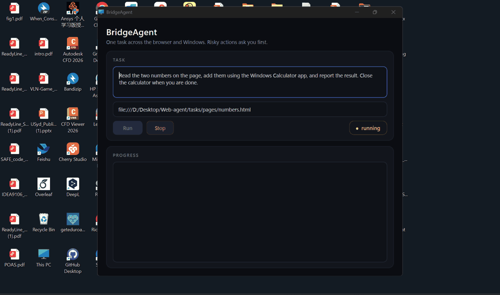
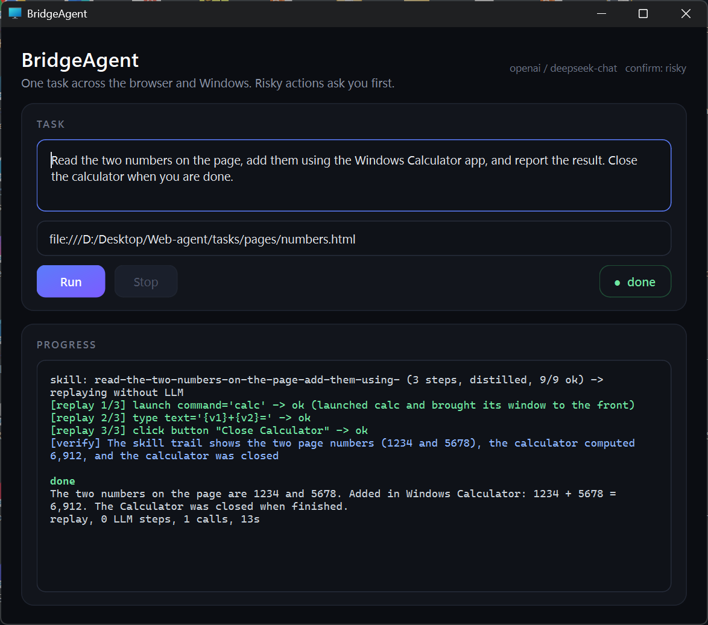

# BridgeAgent

[](LICENSE)
[](pyproject.toml)
[](#limitations)
[](#)
[](https://github.com/Erikdai)

English | [中文](README.zh-CN.md)

**Give your web agent access to Windows.**



BridgeAgent is an AI agent that treats the browser and the Windows desktop as one workspace. It reads web pages
through the DOM and native windows through Windows UI Automation, and switches between the two by a deterministic rule,
not by the model. A task can start on a web
page, continue in Explorer, Calculator, a dialog or any native app, and come back.

Status: alpha. Windows 11, Python 3.11+. Tested with DeepSeek through an OpenAI-compatible endpoint. The Anthropic
backend is wired but untested.


## What it does

- **One tree for two worlds.** Page elements get `b` refs (Playwright), native controls get `d` refs (UI Automation).
  The model sees one accessibility tree per step and picks one action.
- **Deterministic routing.** `focus.py` looks at the foreground window's process and class and decides which observer
  runs. Chrome dialogs drawn outside the page (print preview, permission bubbles) are found through UIA and merged in.
- **Focus-safe execution.** If another app steals the foreground, the agent's window is brought back. Keystrokes are
  only sent when the observed window is still in front, and a vanished window makes the action fail instead of leak.
- **Skills without an LLM.** A successful run is compacted into a skill. The next run replays it and spends one model
  call to verify. If the UI changed, the model takes over from the broken step and the skill is rewritten. Values copied
  from the page become variables, so a replay works on new data.
- **Guard rails the model cannot talk its way around.** A permission manifest (allowed apps, folders, windows,
  credential sites), a native confirmation box for risky actions, passwords served from the OS keyring, and an audit log.
- **Three entry points, one core.** CLI, a small desktop window, and an MCP server so other agents can use the same
  execution layer.



## Architecture

```
                 agent.py: observe -> route -> decide -> act, skills, self-heal
                                   |
      focus.py ----------- llm/ ------------- actions.py ----------- guard.py
   who has focus?    Anthropic / OpenAI     one action schema,    permissions,
                      compatible           two executors        confirmation, audit
         |                                        |
 observers/browser.py  observers/desktop.py   BrowserExecutor  DesktopExecutor
 Playwright DOM scan   Windows UIA walk       (Playwright)     (uiautomation)
         \______________ tree.py: UINode / Observation ______________/

 entry points: cli.py        gui.py (PySide6)        mcp_server.py
 skills/: store, replay, params      credentials/: keyring broker      eval.py: task runner
```

Routing rule: the foreground window belongs to the agent's browser and uses the browser's main window class, so read the
DOM. Anything else (a native window, a dialog owned by the browser, another browser, a Chrome popup) goes through UIA.
Execution follows the ref prefix. The model never chooses the observer or the executor.

## Quick start

```powershell
git clone https://github.com/Erikdai/bridge-agent.git
cd bridge-agent
python -m venv .venv
.\.venv\Scripts\pip install -e ".[gui,dev]"
.\.venv\Scripts\playwright install chromium
copy .env.example .env        # add an API key (see below)
```

`.env` for DeepSeek (any OpenAI-compatible endpoint works the same way):

```
OPENAI_API_KEY=sk-...
OPENAI_BASE_URL=https://api.deepseek.com
OPENAI_MODEL=deepseek-chat
BRIDGE_PROVIDER=openai
```

Run a task that crosses the browser boundary:

```powershell
bridgeagent run "Read the two numbers on the page, add them in the Windows Calculator app, report the result and close the calculator." --start-url file:///<repo>/tasks/pages/numbers.html
bridgeagent run "..."            # the second run replays the learned skill with one verification call
bridgeagent gui                  # task box, progress, approvals, stop, result
bridgeagent mcp                  # execution layer over stdio for other agents
```

Connect it to Claude Code:

```powershell
claude mcp add bridgeagent -- <repo>\.venv\Scripts\bridgeagent.exe mcp
```

Other commands: `focus`, `dump`, `scan URL` (inspect trees without an LLM), `cred set SITE` (store a password in the OS
keyring), `skill list|show|delete|replay`, `perms`, `eval` (run `tasks/examples.yaml`), `notify`.

Safety: copy `permissions.example.yaml` to `permissions.yaml` to restrict which apps, folders, windows and credential
sites the agent may touch. Every action is appended to `runs/audit.jsonl`.

## Evidence

- `docs/EVAL.md`: three passes over eight cross-boundary tasks (first contact 8/8, pure replay for most tasks at one
  model call), a real Explorer-to-web upload workflow, and a ten-scenario deterministic matrix (`scripts/bridge_matrix.py`)
  covering DOM-UIA-DOM transitions, Chrome in-window dialogs, focus hijacking before and after observation, refusal when the
  target window is gone, LLM-free replay and 40 consecutive MCP calls. Small samples, not reliability statistics.
- `docs/RELATED_WORK.md`: how this compares with UFO2, Agent S2, browser-use and RPA tools.

## Limitations

- Windows only. Excel's cell grid exposes only visible header cells to UIA, so spreadsheet reading is not supported.
- Chrome dialog detection relies on Chrome's view class names and may need updating across Chrome versions.
- Skill matching is keyword overlap, and parameterization covers typed text and download paths, not file choices such as
  "the newest file".
- Screenshot fallback for sparse trees needs a vision-capable model.

## License

MIT. See `LICENSE`.
